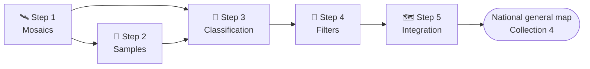

<p align="center">
  
  
</p>

# 🌿 MapBiomas Ecuador – Collection 4

Scripts used by the **MapBiomas Ecuador** team ([EcoCiencia](https://www.ecociencia.org/)) to produce **Collection 4** of the annual land-cover and land-use maps of Ecuador (1985 – present), from Landsat imagery at 30 m with Google Earth Engine.

> **Status:** in review. Each step folder has its own README with the details; items marked `TODO` are pending confirmation.

## 🔁 Workflow

The map is produced in five steps. Steps 2 to 4 are run **one classification region at a time**; step 5 joins all regions into the national map.



| Step | Folder | What it does | Main output |
|---|---|---|---|
| 1 | [`step-1-mosaics`](step-1-mosaics/) | Builds annual Landsat mosaics (cloud and shadow masking, spectral indexes, median and seasonal percentiles), by path/row (Pacific and Andes) and by map sheet (Amazon). Includes the image blacklist and visual checks. | Annual mosaics |
| 2 | [`step-2-samples`](step-2-samples/) | Finds stable pixels (same class in every year of the previous collection, refined with other reference maps), calculates class areas and draws balanced training points. | Training samples per year |
| 3 | [`step-3-classifications`](step-3-classifications/) | Random Forest classification, year by year, with the mosaic bands and static variables (elevation, slope, HAND…). Stacks the years into one multiband image. | Classification, one band per year |
| 4 | [`step-4-filters`](step-4-filters/) | Post-classification filters, in sequence: gap fill → temporal → frequency → spatial. | Filtered classification |
| 5 | [`step-5-integracion`](step-5-integracion/) | Joins the filtered classifications of all regions into the national map. | `ECUADOR-GENERAL-MAP-<version>` |

## 📂 Folder structure

```
collection-4/
├── step-1-mosaics/
│   ├── gee/                                   # Earth Engine Code Editor (JavaScript)
│   │   ├── 01-0-mapbiomas-ecu-blacklist-path-row.js   # Image blacklist per path/row
│   │   ├── 01-1-Visualizacion-v1.js                   # Visual check of mosaics
│   │   ├── 01-2-delete_mosaics.js                     # Delete mosaics to regenerate them
│   │   └── modules/Palettes.js                        # Collection 4 color palette
│   └── python/                                # Earth Engine Python API
│       ├── generate_mosaics_pathrow.py                # Mosaics by path/row
│       ├── generate_mosaics_cartas.py                 # Mosaics by map sheet
│       ├── modules/                                   # Masks, indexes, mosaic functions
│       ├── params/                                    # Example parameter tables
│       └── tools/select_blacklist.py                  # Blacklist helper
├── step-2-samples/
│   ├── 01-0-stable-pixels.js                  # Stable pixels
│   ├── 01-1-stable-pixels-spatial-filter.js   # Remove small patches of stable pixels
│   ├── 01-2-training-areas.js                 # Class areas for balancing
│   └── 01-3-random-points.js                  # Stratified training points
├── step-3-classifications/
│   ├── 02-1-classifier.js                     # Random Forest, year by year
│   └── 02-2-stack-multiband.js                # One band per year
├── step-4-filters/
│   ├── 03-1-gapfill.js                        # Fill years with no data
│   ├── 03-2-temporal-filter.js                # Remove short class interruptions
│   ├── 03-3-frequency-filter.js               # Stabilize natural vegetation
│   └── 03-4-spatial-filter.js                 # Remove isolated pixels
├── step-5-integracion/
│   └── 04-1-integration.js                    # National map
└── step-6-extras/                             # Coming soon
```

## 🧩 How the steps connect

Each script reads the output of the previous one through an **asset name with a version number**, so a step can be repeated without overwriting earlier results.

| Step | Asset pattern | Read by |
|---|---|---|
| 1 | Mosaics `<COUNTRY>-<grid>-<SATELLITE>-<year>-<region>-<version>` | Steps 2 and 3 |
| 2 | Stable pixels `ME-<COUNTRY>-<region>-<version>`; samples `samples-<COUNTRY>-<region>-<year>-p03-<version>` | Step 3 |
| 3 | Classification `<COUNTRY>-<region>-<year>-<version>`; stack `<COUNTRY>-<region>-<version>` | Step 4 |
| 4 | Filtered classification `<COUNTRY>-<region>-<version>` | Next filter / step 5 |
| 5 | `ECUADOR-GENERAL-MAP-<version>` | – |

## 🎨 Legend (main classes)

| ID | Class |
|---|---|
| 3 | Forest formation |
| 4 | Open forest |
| 5 | Mangrove |
| 11 | Wetland |
| 12 | Grassland |
| 13 | Other non-forest natural formation |
| 21 | Mosaic of uses |
| 25 | Other non-vegetated area |
| 27 | Not observed |
| 33 | River, lake or ocean |
| 34 | Glacier |

Colors are defined in the Collection 4 palette (`users/mapbiomasecuador/LULC:MODULES/Palettes.js`, `get('EcuadorCol4')`). `TODO: confirm the class names with the official Collection 4 legend.`

## 🚀 Getting started

1. Get a [Google Earth Engine](https://earthengine.google.com/) account.
2. **JavaScript scripts** (most steps): open them from the repository `users/mapbiomasecuador/LULC` in the [Code Editor](https://code.earthengine.google.com/), or paste them into a new script. Edit the `PARAMS` block at the top and click **Run**.
3. **Python scripts** (step 1, mosaic generation): Python 3.9+, `pip install -r step-1-mosaics/python/requirements.txt` and `earthengine authenticate`.
4. Follow the README of each step, in order.

### Shared requirements

- Code Editor modules (loaded with `require`, must be public):
  - `users/mapbiomasecuador/LULC:MODULES/Palettes.js` – Collection 4 color palette.
  - `users/mapbiomasecuador/LULC:COLECCION4/05-modules/CollectionDirectories.js` – asset paths of the collection (`TODO: publish in collection-4/modules`).
- Input assets of the MapBiomas Ecuador and MapBiomas RAISG Earth Engine projects (`TODO: confirm they are public`).
- Writing assets (exports, deletions) requires write access to those projects.

## 👥 Authors

João Siqueira, Emanuel Valero, Adrián Rodríguez, Fabricio Garcés – MapBiomas Ecuador team, EcoCiencia.

## 📄 License and citation

`TODO: add the license and how to cite MapBiomas Ecuador Collection 4.`

### Contact and more information

This initiative is part of the MapBiomas Network, coordinated by MapBiomas Ecuador. More information at [ecuador.mapbiomas.org](https://ecuador.mapbiomas.org/).
