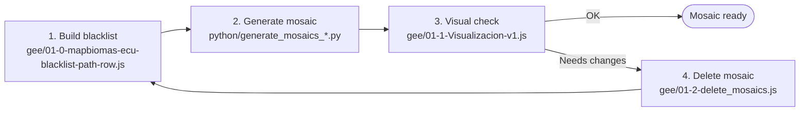

<p align="center">
  
  
</p>

# 🛰️ Step 1 – Annual Landsat Mosaics (Collection 4)

Scripts used by **MapBiomas Ecuador – Collection 4** to build, check and maintain the annual Landsat mosaics. These mosaics are the input of the land-cover classification in the next steps.

## 🌎 Overview

Each annual mosaic is built from **Landsat Collection 2, Level-2** (surface reflectance) images:

1. Clouds and cloud shadows are masked.
2. Spectral mixture fractions and spectral indexes are added (NDVI, EVI2, NDFI, NDWI, etc.).
3. The images of the year are reduced to a median composite plus dry- and wet-season percentiles.

The country is covered by two kinds of mosaic units:

| Area | Mosaic unit | Example | Script |
|---|---|---|---|
| Pacific coast and Andes | Landsat WRS-2 tile (path/row) | `010059` | `generate_mosaics_pathrow.py` |
| Amazon | RAISG map sheet ("carta", 1:250,000 grid) | `SA-18-V-A` | `generate_mosaics_cartas.py` |

Both can optionally apply a topographic (illumination) correction.

## 🔁 Workflow



1. **Build the blacklist.** For each tile and year, open `01-0-mapbiomas-ecu-blacklist-path-row.js` in the Earth Engine Code Editor, inspect every available scene and list the ones that degrade the mosaic (residual clouds, haze, shadows, sensor artifacts). `tools/select_blacklist.py` helps format the list.
2. **Generate the mosaic.** Write the parameters and the blacklist in a CSV table (see [`params/`](python/params/)) and run the matching Python script. It sends one export task per mosaic to Earth Engine.
3. **Check the mosaic.** Open `01-1-Visualizacion-v1.js` and compare it against the satellite basemap and the previous land-cover map.
4. **If it needs changes,** delete it with `01-2-delete_mosaics.js` (an existing asset cannot be overwritten), update the table and go back to step 2.

## 📂 Folder structure

```
step-1-mosaics/
  ├── gee/                                        # JavaScript – Earth Engine Code Editor
  │   ├── 01-0-mapbiomas-ecu-blacklist-path-row.js    # Blacklist: compare mosaics with/without scenes
  │   ├── 01-1-Visualizacion-v1.js                    # Visual check of the generated mosaics
  │   ├── 01-2-delete_mosaics.js                      # Delete mosaics to regenerate them
  │   └── modules/Palettes.js                         # Collection 4 color palette
  └── python/                                     # Python – Earth Engine API
      ├── generate_mosaics_pathrow.py                 # Mosaics by path/row (Pacific, Andes)
      ├── generate_mosaics_cartas.py                  # Mosaics by map sheet (Amazon)
      ├── requirements.txt                            # Python dependencies
      ├── modules/                                    # Processing functions (masks, indexes, mosaic)
      ├── params/                                     # Example parameter tables + column guide
      └── tools/select_blacklist.py                   # Helper to build the BLACKLIST column
```

| Script | Purpose | Changes assets |
|---|---|---|
| [`01-0-mapbiomas-ecu-blacklist-path-row.js`](01-mosaics/gee/01-0-mapbiomas-ecu-blacklist-path-row.js) | Side-by-side comparison of two cloud-masked mosaics of one path/row, with and without the blacklist, using two parameter sets. Lists every scene so it can be blacklisted. | No |
| [`01-1-Visualizacion-v1.js`](01-mosaics/gee/01-1-Visualizacion-v1.js) | Displays the generated mosaics (by map sheet and/or path/row) for one year, with the previous MapBiomas Ecuador map as reference. | No |
| [`01-2-delete_mosaics.js`](01-mosaics/gee/01-2-delete_mosaics.js) | Deletes the mosaics of one map sheet or path/row for one or more years. Dry run by default. | **Yes – deletes** |
| [`generate_mosaics_pathrow.py`](01-mosaics/python/generate_mosaics_pathrow.py) | Generates and exports path/row mosaics from a parameter table. | **Yes – creates** |
| [`generate_mosaics_cartas.py`](01-mosaics/python/generate_mosaics_cartas.py) | Generates and exports map-sheet mosaics from a parameter table. | **Yes – creates** |
| [`select_blacklist.py`](01-mosaics/python/tools/select_blacklist.py) | Interactive selection of scene IDs for the `BLACKLIST` column. | No |

> ⚠️ Generating and deleting mosaics requires write access to the MapBiomas Ecuador / RAISG Earth Engine projects. Always run `01-2` first with `deleteMosaic: false` and check the listed asset IDs.

## 🚀 How to use

### Earth Engine Code Editor (`gee/`)

1. Sign in to the [GEE Code Editor](https://code.earthengine.google.com/).
2. Open the script from the repository `users/mapbiomasecuador/LULC` (folder `COLECCION4/`), or paste it into a new script.
3. Edit the parameters block at the top. Each parameter is documented in place.
4. Click **Run**. Layers are added hidden; turn them on in the **Layers** panel.

### Python (`python/`)

```bash
cd 01-mosaics/python
pip install -r requirements.txt
earthengine authenticate          # once per machine
python generate_mosaics_pathrow.py params/pathrow_example.csv
```

Set `EE_PROJECT` and `TOPOGRAPHIC_CORRECTION` at the top of each script if needed. The export tasks can be followed in the **Tasks** tab of the Code Editor.

## 🧰 Requirements

- A [Google Earth Engine](https://earthengine.google.com/) account; for the Python scripts, Python 3.9+.
- Read access to the input assets:
  - Landsat Collection 2 Level-2 (Earth Engine catalog).
  - Auxiliary vectors: `projects/mapbiomas-ecuador/assets/AUXILIAR-DATA/VECTOR/` and `projects/mapbiomas-raisg/DATOS_AUXILIARES/VECTORES/`.
  - Landsat tile masks: `projects/mapbiomas-workspace/AUXILIAR/landsat-mask`.
  - MapBiomas Ecuador Collection 3 map (reference layer in `01-1`).
- Mosaic collections:

  | Collection | Content |
  |---|---|
  | `projects/mapbiomas-raisg/MOSAICOS/mosaics-pathrow-2` | Path/row mosaics |
  | `projects/mapbiomas-raisg/MAPBIOMAS-ECUADOR/MOSAICOS/mosaics-pathrow-c-topografica` | Path/row mosaics, topographically corrected |
  | `projects/mapbiomas-raisg/MOSAICOS/mosaics-2` | Map-sheet mosaics |
  | `projects/mapbiomas-raisg/MAPBIOMAS-ECUADOR/MOSAICOS/mosaics-cartas-c-topografica` | Map-sheet mosaics, topographically corrected |

- Code Editor modules (loaded with `require`, must be public):
  - `users/mapbiomasecuador/LULC:COLECCION4/01-mosaicos/modules/BandNames.js`
  - `users/mapbiomasecuador/LULC:COLECCION4/modules/Palettes.js`
  - `users/adrrod44/Mapbiomas_Ecuador:COLECCION2/api` (`mapLegend`) – `TODO: move to the official repository`

## 📏 Conventions

| Item | Format | Example |
|---|---|---|
| Path/row | `PPPRRR` (3-digit path + 3-digit row) | `010059` |
| Path/row in tables and in the mosaic property `grid_name` | `_PPPRRR` | `_010059` |
| Map sheet | RAISG sheet name | `SA-18-V-A` |
| Satellite in tables and asset names | `L4`, `L5`, `L7`, `L8`, `L9`, `LX` (L5 + L7), `LY` (L8 + L9) | `L9` |
| Satellite in the mosaic property `satellite` and in GEE scripts | lowercase | `l9` |
| Mosaic asset ID | `<COUNTRY>-<grid>-<SATELLITE>-<year>-<region>-<version>` | `ECUADOR-010059-L9-2025-409-4` |
| Mosaic regions | `409` Pacific; `401`, `402`, `406` – `TODO: names` | – |
| Reflectance and index values | × 10,000 | – |

In 2022 both Landsat 8 and Landsat 9 mosaics exist; scripts select one with the `satellite` parameter.

## ☁️ Cloud and shadow masking

A pixel is removed if any of these masks flags it:

| Mask | Method | Parameter |
|---|---|---|
| QA_PIXEL cloud | Bits 1 (dilated cloud), 2 (cirrus) and 3 (cloud) | – |
| Cloud score | Pixels bright in the visible and infrared bands, cold, and not snow (NDSI) | `CLOUD_THRESH`, `TEMP_MIN`, `TEMP_MAX` |
| QA_PIXEL cloud shadow | Bit 4 | – |
| TDOM + cloud projection | Temporal dark outliers in NIR/SWIR1 located where clouds cast shadows given the sun angle ([Housman et al., 2018](https://www.mdpi.com/2072-4292/10/8/1184/htm)) | `SHADOWSUM` |

The blacklist preview in `01-0` uses the same method as the Python scripts with slightly different settings (dilation of 2 vs 4 pixels, infrared brightness range up to 10,000 vs 8,000), so the final mosaic can differ a little from the preview.

## 👥 Authors

MapBiomas Ecuador team. 
MapBiomas Network team.

The Python processing modules are adapted from the MapBiomas mosaic code.
### Contact and more information

This initiative is part of the MapBiomas Network, coordinated by MapBiomas Ecuador. More information at [ecuador.mapbiomas.org](https://ecuador.mapbiomas.org/).
