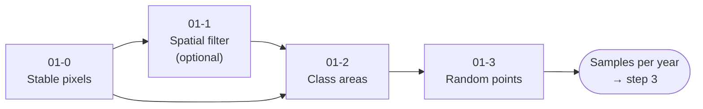

<p align="center">
  
  
</p>

# 🎯 Step 2 – Training Samples (Collection 4)

Scripts used by **MapBiomas Ecuador – Collection 4** to obtain the training samples for the land-cover classification (step 3). Everything runs in the Google Earth Engine Code Editor, one **classification region** at a time.


## 🌎 Overview

Samples are taken only where the land cover is reliable: the **stable pixels**, which kept the same class in every year of the previous collection and agree with other reference maps. The number of samples of each class is balanced according to its area in the region.



1. **Stable pixels (`01-0`).** A pixel is stable if it has the same class in all years of the Collection 3 map, after grouping classes (`remap`). The result can be refined with other sources: previous stable-pixel maps, canopy height, national land-cover maps (2022 and MAG 2024), and ecosystem maps. A source keeps a pixel only if both agree on its class. The analyst can also change or remove classes inside drawn polygons.
2. **Spatial filter (`01-1`, optional).** Removes isolated patches smaller than a minimum number of connected pixels. Only the larger patches remain, so the review is faster.
3. **Class areas (`01-2`).** Calculates the area (km²) of each class in the region, from the stable pixels or from one year of Collection 3.
4. **Random points (`01-3`).** Draws points over the stable pixels, stratified by class. Each class gets points in proportion to its area, with a minimum:

   ```
   points = max( round(classArea / totalArea × sampleSize), minSamples )
   ```

   Then, for each year, it reads the value of every mosaic band and auxiliary variable at those points. The same points are used for all years.

## 📂 Scripts

| Script | Purpose | Output |
|---|---|---|
| [`01-0-stable-pixels.js`](01-0-stable-pixels.js) | Builds and refines the stable-pixel map of a region. | Image `ME-<COUNTRY>-<region>-<version>` |
| [`01-1-stable-pixels-spatial-filter.js`](01-1-stable-pixels-spatial-filter.js) | Removes patches smaller than `minConnectedPixels`. | Image `ME-<COUNTRY>-<region>-<version>` |
| [`01-2-training-areas.js`](01-2-training-areas.js) | Area of each class in the region (km²). | Table `ac-<COUNTRY>-<region>-<version>` (+ optional CSV in Drive) |
| [`01-3-random-points.js`](01-3-random-points.js) | Stratified random points and their band values, per year. | Tables `samples-<COUNTRY>-<region>-<year>-p03-<version>` |

### Versions

Each script reads the output of the previous one by **version number**, so set them consistently:

| Script | Reads | Writes |
|---|---|---|
| `01-0` | – (or a filtered map with `filtroEspacial.use`) | `outputVersion` |
| `01-1` | `inputVersion` = output of 01-0 | `outputVersion` |
| `01-2` | `inputStablePixelsVersion` = output of 01-0 or 01-1 | `outputVersion` |
| `01-3` | `inputVEstablePx` (stable pixels), `inputVAreas` (areas) | `outputVersion` |

## 🚀 How to use

1. Sign in to the [GEE Code Editor](https://code.earthengine.google.com/).
2. Open the script from the repository `users/mapbiomasecuador/LULC` (folder `COLECCION4/`), or paste it into a new script.
3. Edit the `PARAMS` block at the top: at least `regionId` and the versions. Each parameter is documented in place.
4. Click **Run**, review the layers and the console, and start the export from the **Tasks** tab.
5. Repeat for each classification region.

### Review tips

- In `01-0`, compare **Stable pixels – before refinement** with **Stable pixels – to export** over the mosaics. Use the polygons (`exclusion.polygons`) to fix areas with a wrong class: set `original` and `new` with comma-separated class IDs, and use `27` in `new` to remove pixels.
- In `01-3`, check **Samples by class** in the console: classes with very few stable pixels may get fewer points than `minSamples`.

## 🧰 Requirements

- A [Google Earth Engine](https://earthengine.google.com/) account.
- Code Editor modules (loaded with `require`, must be public):
  - `users/mapbiomasecuador/LULC:COLECCION4/05-modules/CollectionDirectories.js` – asset paths of the collection (`TODO: publish in collection-4/modules`).
  - `users/mapbiomasecuador/LULC:MODULES/Palettes.js` – Collection 4 color palette.
- Input assets: classification regions, MapBiomas Ecuador Collection 3 integrated map, annual mosaics (step 1), and the optional reference maps used in `01-0`.
- External datasets used as auxiliary variables in `01-3`:
  - Elevation: `JAXA/ALOS/AW3D30_V1_1` (deprecated in the Earth Engine catalog, kept for consistency with Collection 4).
  - HAND – height above nearest drainage ([Donchyts et al.](https://doi.org/10.3390/rs8050386)): `users/gena/global-hand/hand-100`, `users/gena/GlobalHAND/...`.
  - Shade and slope position: `projects/mapbiomas-raisg/MOSAICOS/shademask2_v3`, `projects/mapbiomas-raisg/MOSAICOS/slppost2_30_v3`.

## 📏 Conventions

| Item | Value |
|---|---|
| Classification region | Field `id_regionC` of the regions asset, e.g. `40201` |
| Stable-pixel band | `reference` (class ID; non-stable pixels are masked) |
| Temporary codes in `01-0` | `27` = remove pixel, `88` = sources disagree (removed) |
| Areas table | One property per class, `ID<class>` = km² (0 if absent) |
| Sample tables | One per year; properties `reference`, `year` and one per band |


## 👥 Authors

João Siqueira, Emanuel Valero, Adrián Rodríguez, Fabricio Garcés – MapBiomas Ecuador team.

### Contact and more information

This initiative is part of the MapBiomas Network, coordinated by MapBiomas Ecuador. More information at [ecuador.mapbiomas.org](https://ecuador.mapbiomas.org/).
