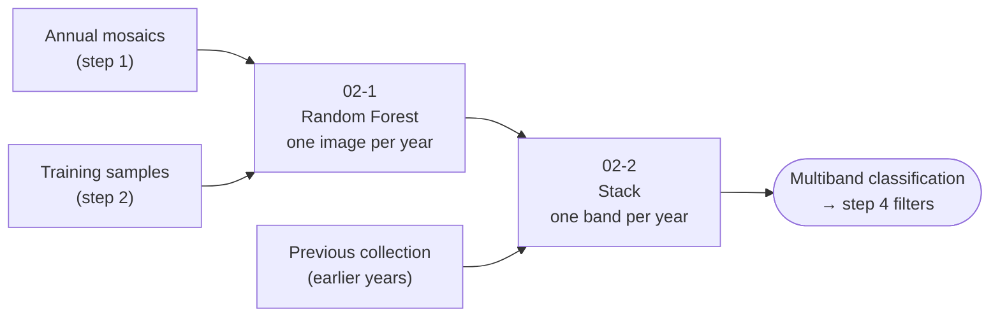
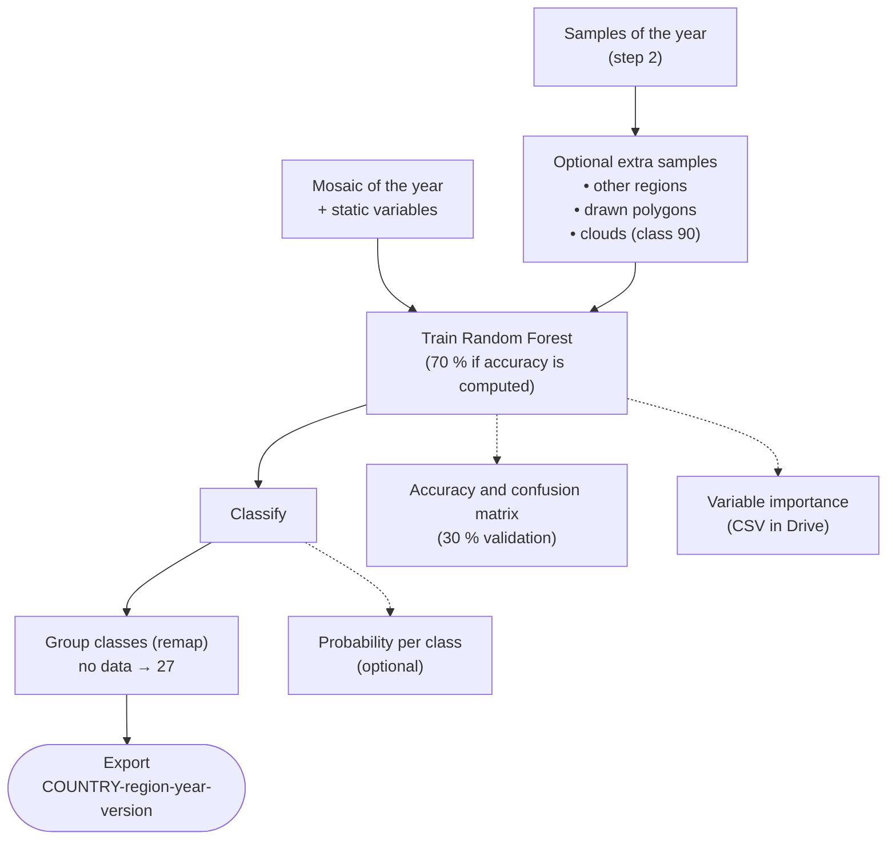

  
  

# 🌳 Step 3 – Classification (Collection 4)

Scripts used by **MapBiomas Ecuador – Collection 4** to classify land cover and land use with **Random Forest**, year by year and one **classification region** at a time, and to gather the annual results into a single multiband image for the next steps (filters and integration).

## 🌎 Overview

1. **Classify (`02-1`).** For each year, the annual mosaic of the region is combined with static variables (elevation, slope, HAND, shade, longitude, latitude). A Random Forest is trained with the samples of that year and applied to the mosaic. The result is grouped into the Collection 4 classes and exported as one image per year.
2. **Stack (`02-2`).** The annual images are gathered into one image with a band per year (`classification_<year>`). Years that are not reclassified can be taken from the previous collection, so the full time series (1985 – present) is complete. If a year exists in both, the new classification is kept.

### What happens inside `02-1`, year by year

## 📂 Scripts

| Script | Purpose | Output |
|---|---|---|
| [`02-1-classifier.js`](02-1-classifier.js) | Random Forest classification of one region, year by year. Optional accuracy, variable importance and probability maps. | Image per year `<COUNTRY>-<region>-<year>-<version>` (band `classification_<year>`) |
| [`02-2-stack-multiband.js`](02-2-stack-multiband.js) | Stacks the annual classifications (and, optionally, years from the previous collection) into one multiband image. Shows every year in a grid of linked maps. | Image `<COUNTRY>-<region>-<version>` (bands `classification_1985` … `classification_<last year>`) |

### Versions

| Script | Reads | Writes |
|---|---|---|
| `02-1` | `samplesVersion` = output of step 2 (`01-3-random-points.js`) | `outputVersion` |
| `02-2` | `currentCollectionVersion` = output of 02-1; `previousCollectionPath` | `outputVersion` |

## ⚙️ Main parameters of `02-1`

| Parameter | Description |
|---|---|
| `regionId` | Classification region (field `id_regionC`). |
| `years` / `yearsPreview` | Years to classify / years added to the map. |
| `mosaicsatellites` | Satellites of the mosaics (`lx`, `l5`, `l7`, `l8`, `l9`). From 2022 on choose `l8` or `l9`; several values use their median. |
| `trees`, `variablesPerSplit` | Random Forest settings (default 120 trees, 1 variable per split). |
| `variables`, `staticVariables` | Mosaic bands and static variables used. `variables: []` uses all mosaic bands. Keep only the static variables that rank high in the importance table. |
| `estadisticos` | Reports accuracy and confusion matrix using 30 % of the samples. **The classification is then trained with the other 70 %.** |
| `tabla_importancia` | Exports the variable importance and out-of-bag error of every year (CSV in Drive). |
| `samplesFromRegions` | Adds samples of selected classes from other regions. |
| `additionalSamples` | Adds samples drawn inside polygons (one class per polygon) drawn in the Code Editor. |
| `aditionalCloudSamples` | Adds cloud samples (class 90) for specific years; clouds become 27 in the output. |
| `probabiltiMap` | Computes one probability band per class (`Id_<class>`). `TODO: set assetFolder` to export it. |
| `addFalseNewYear` | When classifying 2025, also exports it as 2026 (placeholder until a 2026 mosaic exists). |

### Static variables

| Band | Source |
|---|---|
| `altitude` | ALOS World 3D 30 m (`JAXA/ALOS/AW3D30_V1_1`) |
| `slope` | Derived from `altitude` |
| `hand30_100`, `hand30_1000`, `hand30_5000`, `hand90_1000` | HAND – height above nearest drainage ([Donchyts et al.](https://doi.org/10.3390/rs8050386)) |
| `water_HAND_0m` … `water_HAND_10m` | Potential water: HAND below 0–10 m, excluding permanent water (MODIS) |
| `shademask2`, `slppost` | Shade mask and slope position (MapBiomas RAISG) |
| `longitude`, `latitude` | Pixel coordinates |

> The variable names must match those of the training samples (step 2), since the classifier selects bands by name.

### Class grouping after classification

| Classified as | Becomes |
|---|---|
| 6 (flooded forest), 9 (forest plantation) | 3 Forest formation |
| 14, 15, 18, 35 (farming classes) | 21 Mosaic of uses |
| 22, 24, 29, 30 (non-vegetated, urban, rock, mining) | 25 Other non-vegetated area |
| 90 (cloud), no data | 27 Not observed |
| Other classes (3, 4, 5, 11, 12, 13, 21, 25, 33, 34) | unchanged |
| Any class not listed above | 0 |

## 🚀 How to use

1. Sign in to the [GEE Code Editor](https://code.earthengine.google.com/).
2. Open the script from the repository `users/mapbiomasecuador/LULC` (folder `COLECCION4/`), or paste it into a new script.
3. In `02-1`, set at least `regionId`, `samplesVersion`, `years` and `outputVersion`, and click **Run**.
4. Review on the map the classification of the preview years against the mosaic, and check accuracy, confusion matrix and number of samples in the console.
5. If needed, add samples (other regions, polygons, clouds) or remove classes (`removeSamples`) and run again.
6. Start the export tasks from the **Tasks** tab (one per year).
7. In `02-2`, set the years taken from each source and the versions, run, review the grid of years and export.
8. Repeat for each classification region.

## 🧰 Requirements

- A [Google Earth Engine](https://earthengine.google.com/) account.
- Code Editor modules (loaded with `require`, must be public):
  - `users/mapbiomasecuador/LULC:COLECCION4/05-modules/CollectionDirectories.js` – asset paths of the collection.
  - `users/mapbiomasecuador/LULC:MODULES/Palettes.js` – Collection 4 color palette.
- Input assets: classification regions, annual mosaics (step 1), training samples (step 2), previous collection classification, current national land-cover map (reference layer).
- External datasets: `JAXA/ALOS/AW3D30_V1_1` (deprecated in the Earth Engine catalog, kept for consistency), HAND (`users/gena/...`), MODIS water mask `MODIS/MOD44W/MOD44W_005_2000_02_24`.

## 📏 Conventions

| Item | Value |
|---|---|
| Classification band | `classification_<year>`, class IDs as `byte` |
| Not observed / no data | `27` |
| Cloud samples | `90` (grouped to `27`) |
| Annual classification asset | `<COUNTRY>-<region>-<year>-<version>` |
| Multiband stack asset | `<COUNTRY>-<region>-<version>` |
| Importance table (Drive) | `importance-<COUNTRY>-<region>-<version>.csv` |

## 👥 Authors

MapBiomas Ecuador team.
MapBiomas Network team.

### Contact and more information

This initiative is part of the MapBiomas Network, coordinated by MapBiomas Ecuador. More information at [ecuador.mapbiomas.org](https://ecuador.mapbiomas.org/).
