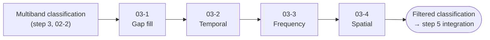

<p align="center">
  
  
</p>

# 🧹 Step 4 – Post-classification Filters (Collection 4)

Scripts used by **MapBiomas Ecuador – Collection 4** to clean the Random Forest classification (step 3) before the integration. The filters fill gaps, remove implausible changes over time and remove isolated pixels, one **classification region** at a time.


## 🌎 Overview

The filters are applied **in sequence**: each one reads the output of the previous one (by version number) and exports a new version of the same multiband image (one band `classification_<year>` per year).



| Filter | Works on | What it fixes |
|---|---|---|
| **03-1 Gap fill** | Time, pixel by pixel | Years with no data (clouds, missing mosaics, class 27) |
| **03-2 Temporal** | Time, pixel by pixel | Short interruptions of a class (1–3 years) and unstable first/last years |
| **03-3 Frequency** | Whole time series, pixel by pixel | Pixels that are almost always natural vegetation but switch class in some years |
| **03-4 Spatial** | Space, year by year | Isolated pixels and very small patches ("salt and pepper") |

## 🔍 How each filter works

### 03-1 Gap fill

Pixels with no information in a year (masked or class `27`, not observed) take the class of the nearest valid year. Years missing from the input are added and filled in the same way.

```
Year:      2000  2001  2002  2003  2004
Input:      3    27    27     21    21
Output:     3     3     3     21    21     (fillOrder 't0tn_tnt0': past years first)
```

- `fillOrder: 't0tn_tnt0'` fills first from past years, then the remaining gaps (e.g. at the start of the series) from future years. `'tnt0_t0tn'` does the opposite.
- `exclusion.clases`: classes that are neither filled nor used to fill other years.
- `exclusion.years`: years that keep their values and do not pass them to other years; with `refill: true` their own gaps are filled afterwards.

### 03-2 Temporal filter

Removes short interruptions: if a class disappears for 1 to 3 years and comes back, the interruption takes that class.

| Rule | Pattern (class FF, other class NV) | Result |
|---|---|---|
| `first3` | **NV** FF FF (first year) | FF FF FF |
| `middle3` | FF **NV** FF | FF FF FF |
| `middle4` + `middle3` | FF **NV NV** FF | FF FF FF FF |
| `middle5` + `middle4` + `middle3` | FF **NV NV NV** FF | FF FF FF FF FF |
| `last3` | FF FF **NV** (last year) | FF FF FF |

- Rules run in the order of `filterExecution` and, inside each rule, class by class in the order of `order`: **the first class has priority**.
- `middle4` and `middle5` only fix the first year of the interruption; that is why they are always followed by `middle3` (and `middle4`).
- `exclusion.years` are used as neighbors but keep their values; `ignore.years` are left out of the filter completely.
- `hidden` restricts the filter to a drawn area or mask (`inside: true` = only inside).

### 03-3 Frequency filter

Looks at the whole time series of each pixel. If the pixel is stable in the selected classes (`classIds`, usually natural vegetation and water), **all its years** become its dominant class:

1. % of years in any of `classIds` > `percents.naturalVegetation` (default 80 %), and
2. % of years in one class > `percents.majority` (default 60 %).

```
42 years: forest (3) in 30 years (71 %), class 13 in 6 years, class 21 in 6 years
-> natural classes 86 % > 80 % and forest 71 % > 60 %  ->  forest in all 42 years
```

- Pixels with no data in any year are not changed.
- `hidden` excludes a drawn area (`inside: false` = filter only **outside** the polygon).

### 03-4 Spatial filter

Year by year, removes patches of the same class smaller than `minConnectedPixels` (default 5 pixels of 30 m) and fills them with the most frequent class around them (focal mode, 5-pixel window).

```
Before            After
3 3 3 3 3         3 3 3 3 3
3 3 21 3 3   ->   3 3 3 3 3
3 3 3 3 3         3 3 3 3 3
```

`eightConnected: true` also counts diagonal neighbors as connected.

## 📂 Scripts

| Script | Input | Output |
|---|---|---|
| [`03-1-gapfill.js`](03-1-gapfill.js) | Stack from step 3 (`02-2-stack-multiband.js`) | `<COUNTRY>-<region>-<version>` |
| [`03-2-temporal-filter.js`](03-2-temporal-filter.js) | Output of 03-1 | `<COUNTRY>-<region>-<version>` |
| [`03-3-frequency-filter.js`](03-3-frequency-filter.js) | Output of 03-2 | `<COUNTRY>-<region>-<version>` |
| [`03-4-spatial-filter.js`](03-4-spatial-filter.js) | Output of 03-3 | `<COUNTRY>-<region>-<version>` |

### Versions

Every filter writes to the same folder (`paths.pathClassificationFilterGM`), so each one needs its own version number. Example of a full chain:

| Script | `inputVersion` | `outputVersion` |
|---|---|---|
| `03-1` gap fill | 1 (stack from step 3) | 996 |
| `03-2` temporal | 996 | 995 |
| `03-3` frequency | 995 | 994 |
| `03-4` spatial | 994 | 993 |


## 🚀 How to use

1. Sign in to the [GEE Code Editor](https://code.earthengine.google.com/).
2. Open the filter from the repository `users/mapbiomasecuador/LULC` (folder `COLECCION4/`), or paste it into a new script.
3. Set `regionId`, `inputVersion` and `outputVersion` (and the filter options) in `PARAMS`.
4. Click **Run** and review the result:
   - For each preview year, the layers are ordered **Mosaic → Classification → Filter result**: turn them on together to compare.
   - The console shows area charts (ha) per class for the filtered result, the input and the previous collection (`Graficar` / `plot`). They are resampled to 250 m, so use them as a reference only.
5. Start the export from the **Tasks** tab.
6. Run the next filter with `inputVersion` = the version just exported.
7. Repeat for each classification region.

## 🧰 Requirements

- A [Google Earth Engine](https://earthengine.google.com/) account.
- Code Editor modules (loaded with `require`, must be public):
  - `users/mapbiomasecuador/LULC:COLECCION4/05-modules/CollectionDirectories.js` – asset paths of the collection (`TODO: publish in collection-4/modules`).
  - `users/mapbiomasecuador/LULC:MODULES/Palettes.js` – Collection 4 color palette.
- Input assets (`TODO: confirm they are public`): classification regions, annual mosaics (step 1), multiband classification (step 3) and MapBiomas Ecuador Collection 3 (charts).

## 📏 Conventions

| Item | Value |
|---|---|
| Bands | `classification_<year>`, class IDs as `byte` |
| Not observed / no data | `27` (filled by `03-1`) |
| Output asset | `<COUNTRY>-<region>-<version>` in `paths.pathClassificationFilterGM` |
| Properties | `regions`, `country`, `version`, `step` (filter name), `theme` |

## 👥 Authors

MapBiomas Ecuador team.
MapBiomas Network team.

### Contact and more information

This initiative is part of the MapBiomas Network, coordinated by MapBiomas Ecuador. More information at [ecuador.mapbiomas.org](https://ecuador.mapbiomas.org/).
