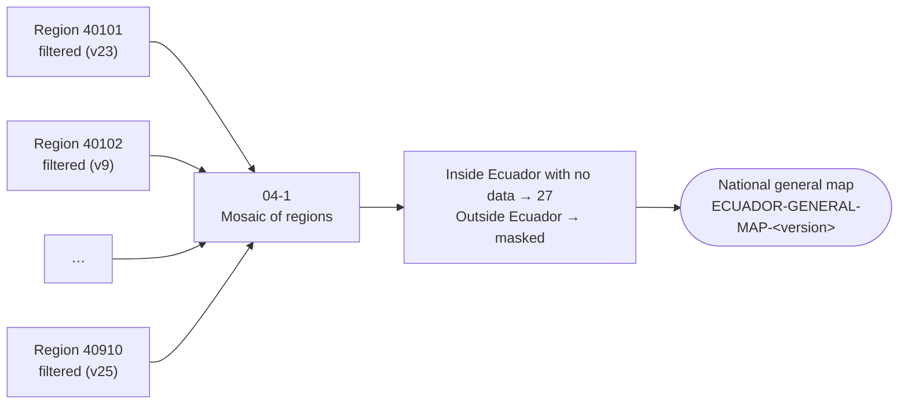

<p align="center">
  
  
</p>

# 🗺️ Step 5 – Integration (Collection 4)

Script used by **MapBiomas Ecuador – Collection 4** to join the filtered classifications of all classification regions into the **national general map**: one image covering Ecuador with one band per year.


## 🌎 Overview

Each classification region is classified (step 3) and filtered (step 4) separately. The integration takes the final version of every region and mosaics them into a single national image.



1. **Load** the final filtered image of each region, using the version listed for it in `REGION_VERSIONS`.
2. **Mosaic** all regions into one image. If two regions overlap, the region listed **last** in `REGION_VERSIONS` is kept.
3. **Complete** the national coverage: pixels inside Ecuador without a classification get class `27` (not observed); pixels outside Ecuador are masked.
4. **Export** the national multiband image (`classification_<year>` bands) with collection metadata.

## 📂 Script

| Script | Input | Output |
|---|---|---|
| [`04-1-integration.js`](04-1-integration.js) | Filtered image of each region (step 4): `classification-ft/ECUADOR-<region>-<version>` | `INTEGRATION/integration/ECUADOR-GENERAL-MAP-<outputVersion>` |

### Choosing the version of each region

Every region goes through its own chain of filters, so its final version number is different. The table `REGION_VERSIONS` at the top of the script lists them:

```js
var REGION_VERSIONS = [
  [40101, 23], [40102, 9], [40103, 14], ...   // [regionId, final filter version]
];
```

Before running the integration, update each entry with the version that passed the review in step 4.

## 🚀 How to use

1. Sign in to the [GEE Code Editor](https://code.earthengine.google.com/).
2. Open `04-1-integration.js` from the repository `users/mapbiomasecuador/LULC` (folder `COLECCION4/`), or paste it into a new script.
3. Update `REGION_VERSIONS` and set `outputVersion` in `PARAMS`.
4. Click **Run**:
   - The console lists the region assets that are integrated (check that all exist).
   - The map shows one layer per year (`ECUADOR <year>`) and the outline of the classification regions, to check borders between regions.
5. Start the export from the **Tasks** tab.

## 🧰 Requirements

- A [Google Earth Engine](https://earthengine.google.com/) account.
- Code Editor module: `users/mapbiomasecuador/LULC:MODULES/Palettes.js` – Collection 4 color palette.
- Input assets:
  - Filtered classifications of every region (step 4).
  - Country boundary: `projects/mapbiomas-ecuador/assets/AUXILIAR-DATA/VECTOR/COLLECTION-4/nivel_politico_1_col4`.
  - Classification regions: `projects/mapbiomas-ecuador/assets/AUXILIAR-DATA/VECTOR/COLLECTION-4/regionesClassif_Col4_v1`.

## 📏 Output

| Item | Value |
|---|---|
| Asset | `ECUADOR-GENERAL-MAP-<outputVersion>` |
| Bands | `classification_<year>`, class IDs as `byte`, 30 m, EPSG:4326 |
| Not observed / no data | `27` |
| Properties | `version`, `collection` (`4.0`), `country`, `source` (`EcoCiencia`), `theme` (`GENERAL-MAP`), `created` (date and time) |

> `TODO:` the map preview covers 1985–2025. If the regional images include a 2026 band (placeholder created in step 3 with `addFalseNewYear`), it is also exported; confirm whether it should be kept in the national map.

## 👥 Authors

MapBiomas Ecuador team.
MapBiomas Network team.

### Contact and more information

This initiative is part of the MapBiomas Network, coordinated by MapBiomas Ecuador. More information at [ecuador.mapbiomas.org](https://ecuador.mapbiomas.org/).
